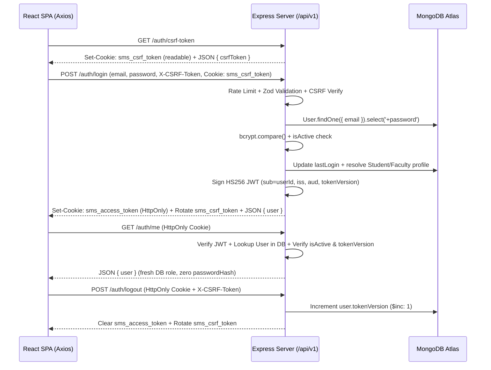

# Student Management System (SMS)
## Phase 4: Authentication, JWT, Password Security & Role-Based Access Control (RBAC)

**Academic Context:** B.Tech CSE Mini Project  
**Course Code:** BCS 554 | **Academic Session:** 2026–27  
**University:** Dr. A.P.J. Abdul Kalam Technical University (AKTU)  

---

### 1. Architecture Overview

Phase 4 implements end-to-end cryptographic authentication and role-based access control across both the Express/MongoDB backend and the React frontend, enforcing:
- **Lowercase Role Identifiers (`admin`, `faculty`, `student`)** in MongoDB and backend authorization logic (with uppercase display labels in the frontend UI).
- **HttpOnly Cookie JWT Transmission** (`sms_access_token`) with zero browser storage (`localStorage`/`sessionStorage`) of tokens.
- **Double-Submit Cookie CSRF Protection** (`sms_csrf_token` + `X-CSRF-Token` header verified via constant-time `crypto.timingSafeEqual`).
- **Deterministic Session Revocation** using a per-user `tokenVersion` counter on `User`, ensuring logout and password updates invalidate any copied JWTs immediately.
- **Live Database Role & Status Checks** on every protected request so deleted, disabled, or role-changed accounts are enforced immediately without waiting for token expiry.

---

### 2. Authentication & Security Flow



---

### 3. Record-Level Authorization Roadmap (Future Phases)

Role checks (`authorizeRoles('admin')`, `authorizeRoles('faculty')`, `authorizeRoles('student')`) prevent vertical privilege escalation, while later business modules (Phases 5+) must combine them with record-ownership and assignment tenancy checks:
- **Student Tenancy (`student`):** Queries/mutations involving `studentId` must assert `req.user.profileId === targetStudentId` (ignoring arbitrary `studentId` values supplied in body/params).
- **Faculty Scoping (`faculty`):** Attendance marking (`POST /attendance`) and marks entry (`POST /results/marks`) must assert an active `FacultyAssignment` linking `req.user.profileId` to the target `subject`, `semester`, and `section`.
- **Admin Governance (`admin`):** Full administrative visibility and audit logging on master data mutations (`AuditLog`).

---

### 4. Controlled User Provisioning

Public self-registration is intentionally disabled. Initial administrators are provisioned safely via CLI or environment variables:
```bash
cd server
npm run provision:admin -- --email=admin@aktu.ac.in --password="StrongPassword@123"
```
Legacy role migration utility (normalizes uppercase roles to lowercase safely):
```bash
cd server
node utils/migrateRoles.js
```
