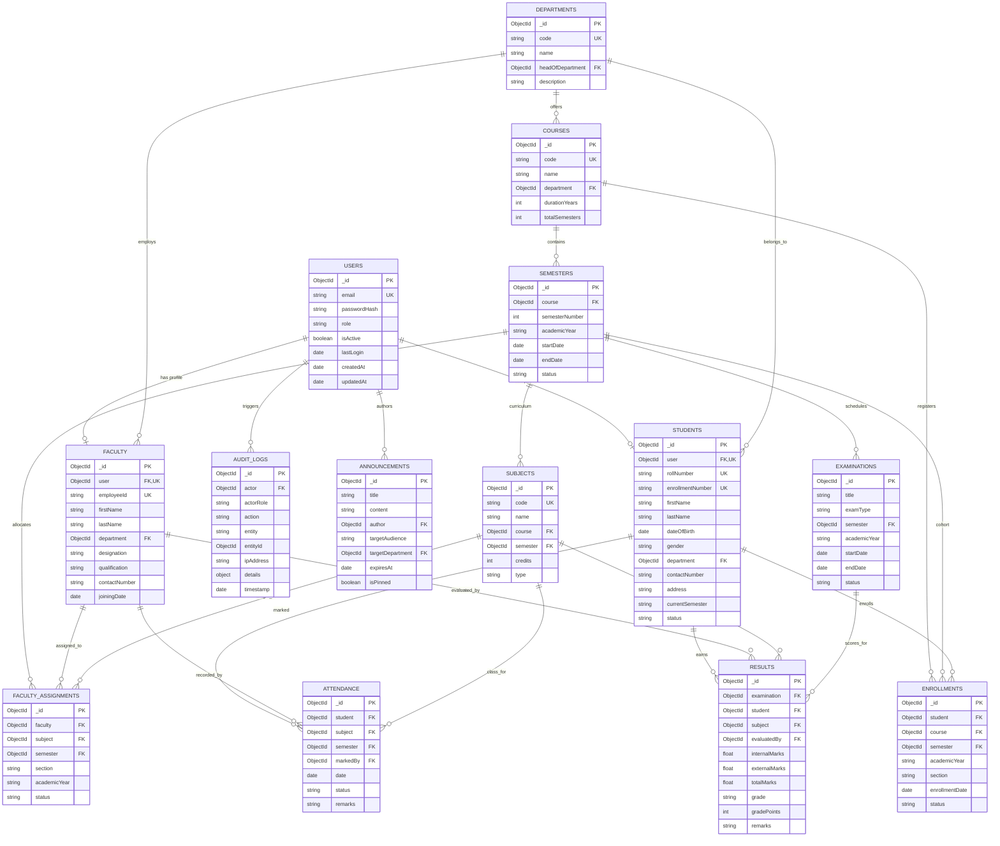

# Student Management System (SMS)
## Document 07: Database Architecture, Schemas & Entity-Relationship (ER) Design

---

### 1. Database Architectural Principles & Schema Philosophy

The Student Management System utilizes **MongoDB Atlas** as its document-oriented database engine, orchestrated via **Mongoose ODM (v8.x)**.

While MongoDB is inherently schema-less, an academic management system mandates strict data integrity, referential consistency, and non-corruptible record relationships. We adopt a **Hybrid Relational-Document Modeling Philosophy**:
1. **Normalized References for Core Entities:** Master entities (Users, Students, Faculty, Departments, Courses, Semesters, Subjects) use Mongoose `ObjectId` references (`ref: '...'`) to prevent stale data anomalies.
2. **Denormalization for High-Velocity Queries:** Frequently accessed, immutable snapshots (e.g., storing student Roll Number, Subject Code alongside ObjectIds in attendance or results) are selectively embedded to eliminate expensive multi-collection `$lookup` joins on critical dashboard read paths.
3. **Database-Level Compound Indexing:** Strict data integrity rules (e.g., preventing duplicate attendance per date or duplicate semester enrollments) are guaranteed at the MongoDB B-tree index layer via compound `unique: true` constraints.
4. **Soft-Deletion & Referential Protection:** To prevent orphaned records and preserve historical transcripts, deletions of parent entities (such as Departments or Courses) are checked via Mongoose pre-hook middleware to block deletion if active child records exist.
5. **Auditing by Default:** Every collection is configured with `{ timestamps: true }`, automatically generating immutable `createdAt` and mutable `updatedAt` ISO 8601 timestamps.

---

### 2. Entity-Relationship (ER) Diagram

---

### 3. Detailed Data Dictionary & Collection Specifications

#### 3.1 Collection: `Users`
- **Purpose:** Central credentials and authentication store.
- **Fields:**
  - `_id`: `ObjectId` (Primary Key).
  - `email`: `String`, Required, Unique, Lowercase, Trim, Indexed.
  - `password`: `String`, Required (bcrypt hash, 60 chars).
  - `role`: `String`, Required, Enum: `['ADMIN', 'FACULTY', 'STUDENT']`, Default: `'STUDENT'`.
  - `isActive`: `Boolean`, Required, Default: `true`.
  - `lastLogin`: `Date`, Optional.
  - `createdAt`, `updatedAt`: `Date` (Automated).
- **Indexes:**
  - `{ email: 1 }` (Unique).
  - `{ role: 1, isActive: 1 }`.

#### 3.2 Collection: `Students`
- **Purpose:** Detailed personal, demographic, and institutional profile of students.
- **Fields:**
  - `_id`: `ObjectId` (Primary Key).
  - `user`: `ObjectId`, Ref: `'User'`, Required, Unique.
  - `rollNumber`: `String`, Required, Unique, Trim, Uppercase (e.g., `2200270100045`).
  - `enrollmentNumber`: `String`, Required, Unique, Trim, Uppercase.
  - `firstName`: `String`, Required, Trim.
  - `lastName`: `String`, Required, Trim.
  - `dateOfBirth`: `Date`, Required.
  - `gender`: `String`, Required, Enum: `['MALE', 'FEMALE', 'OTHER']`.
  - `department`: `ObjectId`, Ref: `'Department'`, Required.
  - `contactNumber`: `String`, Required, Validated regex `^[0-9]{10}$`.
  - `address`: `String`, Required.
  - `currentSemester`: `Number`, Required, Min: 1, Max: 8.
  - `status`: `String`, Enum: `['ACTIVE', 'INACTIVE', 'SUSPENDED', 'GRADUATED']`, Default: `'ACTIVE'`.
- **Indexes:**
  - `{ rollNumber: 1 }` (Unique).
  - `{ enrollmentNumber: 1 }` (Unique).
  - `{ department: 1, currentSemester: 1 }`.

#### 3.3 Collection: `Faculty`
- **Purpose:** Academic instructional profile.
- **Fields:**
  - `_id`: `ObjectId` (Primary Key).
  - `user`: `ObjectId`, Ref: `'User'`, Required, Unique.
  - `employeeId`: `String`, Required, Unique, Trim, Uppercase (e.g., `FAC-CSE-012`).
  - `firstName`: `String`, Required, Trim.
  - `lastName`: `String`, Required, Trim.
  - `department`: `ObjectId`, Ref: `'Department'`, Required.
  - `designation`: `String`, Required, Enum: `['PROFESSOR', 'ASSOCIATE_PROFESSOR', 'ASSISTANT_PROFESSOR', 'LECTURER']`.
  - `qualification`: `String`, Required (e.g., `Ph.D, M.Tech`).
  - `contactNumber`: `String`, Required.
  - `joiningDate`: `Date`, Required.
- **Indexes:**
  - `{ employeeId: 1 }` (Unique).
  - `{ department: 1 }`.

#### 3.4 Collection: `Departments`
- **Purpose:** Institutional faculties and academic divisions.
- **Fields:**
  - `_id`: `ObjectId` (Primary Key).
  - `code`: `String`, Required, Unique, Uppercase, Trim (e.g., `CSE`, `ECE`, `ME`).
  - `name`: `String`, Required, Trim (e.g., `Computer Science & Engineering`).
  - `headOfDepartment`: `ObjectId`, Ref: `'Faculty'`, Optional.
  - `description`: `String`, Optional.
- **Indexes:**
  - `{ code: 1 }` (Unique).

#### 3.5 Collection: `Courses`
- **Purpose:** Degree programs and curricula offered.
- **Fields:**
  - `_id`: `ObjectId` (Primary Key).
  - `code`: `String`, Required, Unique, Uppercase, Trim (e.g., `BTECH-CSE`).
  - `name`: `String`, Required, Trim (e.g., `Bachelor of Technology in Computer Science & Engineering`).
  - `department`: `ObjectId`, Ref: `'Department'`, Required.
  - `durationYears`: `Number`, Required, Default: 4.
  - `totalSemesters`: `Number`, Required, Default: 8.
- **Indexes:**
  - `{ code: 1 }` (Unique).
  - `{ department: 1 }`.

#### 3.6 Collection: `Semesters`
- **Purpose:** Academic calendar cycles and terms.
- **Fields:**
  - `_id`: `ObjectId` (Primary Key).
  - `course`: `ObjectId`, Ref: `'Course'`, Required.
  - `semesterNumber`: `Number`, Required, Min: 1, Max: 10.
  - `academicYear`: `String`, Required (e.g., `2026-2027`).
  - `startDate`: `Date`, Required.
  - `endDate`: `Date`, Required.
  - `status`: `String`, Enum: `['UPCOMING', 'ACTIVE', 'COMPLETED']`, Default: `'UPCOMING'`.
- **Indexes:**
  - `{ course: 1, semesterNumber: 1, academicYear: 1 }` (Unique).

#### 3.7 Collection: `Subjects`
- **Purpose:** Curricular study courses/modules.
- **Fields:**
  - `_id`: `ObjectId` (Primary Key).
  - `code`: `String`, Required, Unique, Uppercase, Trim (e.g., `BCS-554`).
  - `name`: `String`, Required, Trim.
  - `course`: `ObjectId`, Ref: `'Course'`, Required.
  - `semester`: `ObjectId`, Ref: `'Semester'`, Required.
  - `credits`: `Number`, Required, Min: 1, Max: 6.
  - `type`: `String`, Enum: `['THEORY', 'PRACTICAL', 'ELECTIVE', 'PROJECT']`, Default: `'THEORY'`.
- **Indexes:**
  - `{ code: 1 }` (Unique).
  - `{ semester: 1 }`.

#### 3.8 Collection: `Enrollments`
- **Purpose:** Maps student registration into semester cohorts.
- **Fields:**
  - `_id`: `ObjectId` (Primary Key).
  - `student`: `ObjectId`, Ref: `'Student'`, Required.
  - `course`: `ObjectId`, Ref: `'Course'`, Required.
  - `semester`: `ObjectId`, Ref: `'Semester'`, Required.
  - `academicYear`: `String`, Required.
  - `section`: `String`, Required, Default: `'A'`.
  - `enrollmentDate`: `Date`, Default: `Date.now`.
  - `status`: `String`, Enum: `['ENROLLED', 'PROMOTED', 'DETAINED', 'WITHDRAWN']`, Default: `'ENROLLED'`.
- **Indexes:**
  - `{ student: 1, semester: 1, academicYear: 1 }` (Compound Unique - prevents duplicate enrollment in same term).
  - `{ semester: 1, section: 1 }`.

#### 3.9 Collection: `FacultyAssignments`
- **Purpose:** Maps teaching workloads.
- **Fields:**
  - `_id`: `ObjectId` (Primary Key).
  - `faculty`: `ObjectId`, Ref: `'Faculty'`, Required.
  - `subject`: `ObjectId`, Ref: `'Subject'`, Required.
  - `semester`: `ObjectId`, Ref: `'Semester'`, Required.
  - `section`: `String`, Required (e.g., `'A'`).
  - `academicYear`: `String`, Required.
  - `status`: `String`, Enum: `['ACTIVE', 'COMPLETED', 'REVOKED']`, Default: `'ACTIVE'`.
- **Indexes:**
  - `{ faculty: 1, subject: 1, semester: 1, section: 1, academicYear: 1 }` (Compound Unique).
  - `{ subject: 1, section: 1, academicYear: 1 }`.

#### 3.10 Collection: `Attendance`
- **Purpose:** Daily session-by-session student attendance log.
- **Fields:**
  - `_id`: `ObjectId` (Primary Key).
  - `student`: `ObjectId`, Ref: `'Student'`, Required.
  - `subject`: `ObjectId`, Ref: `'Subject'`, Required.
  - `semester`: `ObjectId`, Ref: `'Semester'`, Required.
  - `markedBy`: `ObjectId`, Ref: `'Faculty'`, Required.
  - `date`: `Date`, Required (Normalized to UTC midnight).
  - `status`: `String`, Enum: `['PRESENT', 'ABSENT', 'LATE', 'EXCUSED']`, Required.
  - `remarks`: `String`, Optional.
- **Indexes:**
  - `{ student: 1, subject: 1, date: 1, semester: 1 }` (Compound Unique - Absolute guarantee against duplicate marks).
  - `{ subject: 1, date: 1 }`.
  - `{ student: 1, status: 1 }`.

#### 3.11 Collection: `Examinations`
- **Purpose:** Defines evaluation milestones.
- **Fields:**
  - `_id`: `ObjectId` (Primary Key).
  - `title`: `String`, Required (e.g., `'Sessional Exam 1'`).
  - `examType`: `String`, Enum: `['SESSIONAL_1', 'SESSIONAL_2', 'PRE_UNIVERSITY', 'END_SEMESTER']`, Required.
  - `semester`: `ObjectId`, Ref: `'Semester'`, Required.
  - `academicYear`: `String`, Required.
  - `startDate`: `Date`, Required.
  - `endDate`: `Date`, Required.
  - `status`: `String`, Enum: `['UPCOMING', 'ONGOING', 'COMPLETED', 'PUBLISHED']`, Default: `'UPCOMING'`.
- **Indexes:**
  - `{ semester: 1, examType: 1, academicYear: 1 }` (Compound Unique).

#### 3.12 Collection: `Results`
- **Purpose:** Student academic scorecards and grade awards.
- **Fields:**
  - `_id`: `ObjectId` (Primary Key).
  - `examination`: `ObjectId`, Ref: `'Examination'`, Required.
  - `student`: `ObjectId`, Ref: `'Student'`, Required.
  - `subject`: `ObjectId`, Ref: `'Subject'`, Required.
  - `evaluatedBy`: `ObjectId`, Ref: `'Faculty'`, Required.
  - `internalMarks`: `Number`, Required, Min: 0, Max: 50.
  - `externalMarks`: `Number`, Optional, Min: 0, Max: 100.
  - `totalMarks`: `Number`, Required, Min: 0.
  - `grade`: `String`, Enum: `['A+', 'A', 'B+', 'B', 'C', 'D', 'P', 'F']`, Required.
  - `gradePoints`: `Number`, Required, Min: 0, Max: 10.
  - `remarks`: `String`, Optional.
- **Indexes:**
  - `{ examination: 1, student: 1, subject: 1 }` (Compound Unique).
  - `{ student: 1, examination: 1 }`.

#### 3.13 Collection: `Announcements`
- **Purpose:** Broadcast notices.
- **Fields:**
  - `_id`: `ObjectId` (Primary Key).
  - `title`: `String`, Required, Trim.
  - `content`: `String`, Required.
  - `author`: `ObjectId`, Ref: `'User'`, Required.
  - `targetAudience`: `String`, Enum: `['ALL', 'FACULTY', 'STUDENTS', 'DEPARTMENT']`, Default: `'ALL'`.
  - `targetDepartment`: `ObjectId`, Ref: `'Department'`, Optional.
  - `expiresAt`: `Date`, Optional.
  - `isPinned`: `Boolean`, Default: `false`.
- **Indexes:**
  - `{ targetAudience: 1, createdAt: -1 }`.
  - `{ expiresAt: 1 }`.

#### 3.14 Collection: `AuditLogs`
- **Purpose:** Security audit trail.
- **Fields:**
  - `_id`: `ObjectId` (Primary Key).
  - `actor`: `ObjectId`, Ref: `'User'`, Required.
  - `actorRole`: `String`, Required.
  - `action`: `String`, Enum: `['CREATE', 'UPDATE', 'DELETE', 'LOGIN', 'LOGOUT', 'OVERRIDE']`, Required.
  - `entity`: `String`, Required.
  - `entityId`: `ObjectId`, Optional.
  - `ipAddress`: `String`, Required.
  - `details`: `Object`, Optional.
  - `timestamp`: `Date`, Default: `Date.now`.
- **Indexes:**
  - `{ timestamp: -1 }`.
  - `{ actor: 1, timestamp: -1 }`.
  - `{ entity: 1, entityId: 1 }`.

---

### 4. Integrity Preservation & Referential Deletion Strategy

To prevent database corruption without complex distributed database transactions:
1. **Restrict on Parent Deletion:** Before deleting a `Department`, check:
   $$\text{count}(\text{Courses where department} = id) + \text{count}(\text{Students where department} = id) = 0$$
   If count $> 0$, the controller rejects with `400 Bad Request: Cannot delete department containing active courses or students`.
2. **Soft Deactivation Preferred:** In enterprise software, students and faculty are updated to `status: 'INACTIVE'` or `status: 'GRADUATED'` rather than physically deleted from MongoDB, preserving historic results and attendance integrity.
