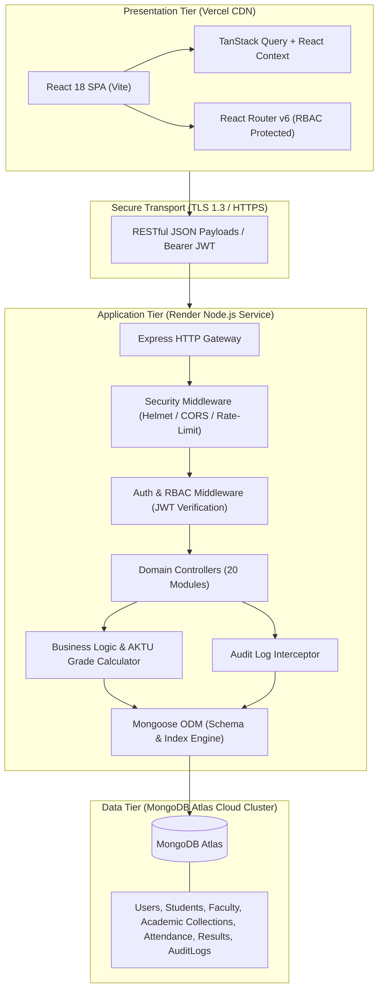
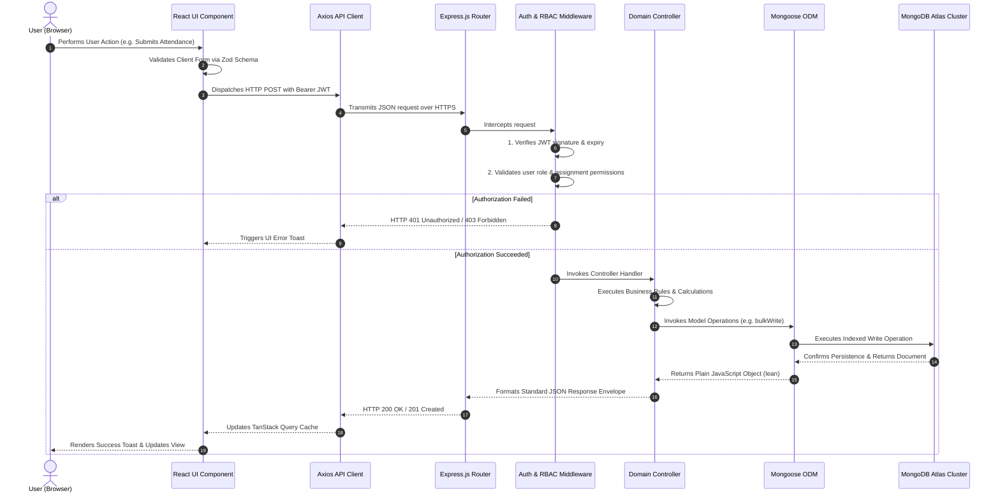
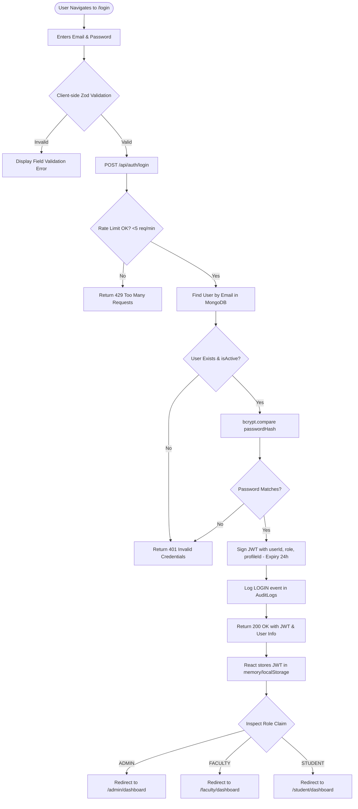
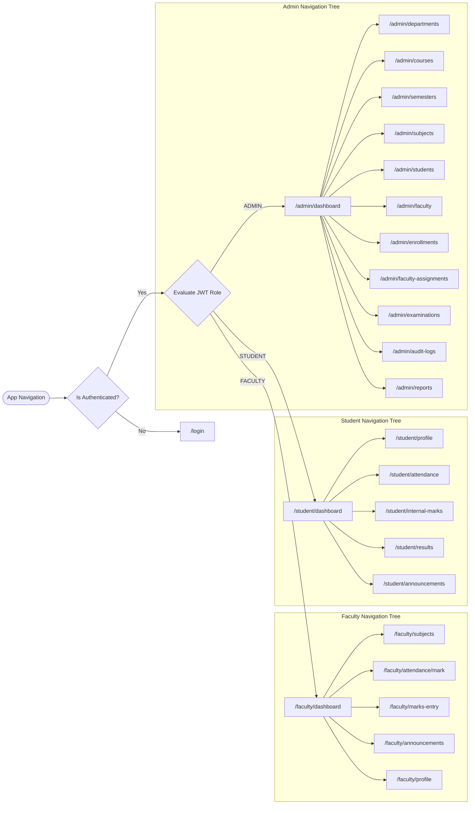
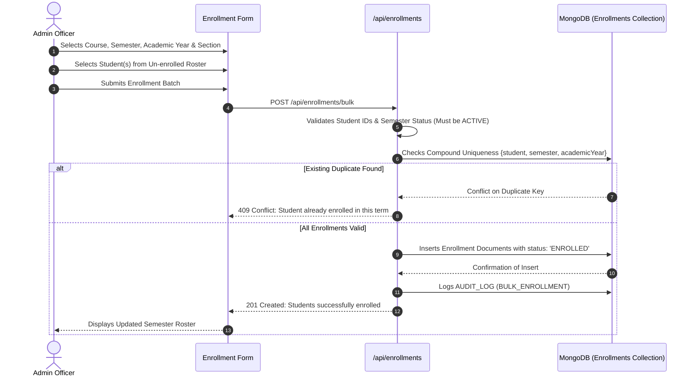
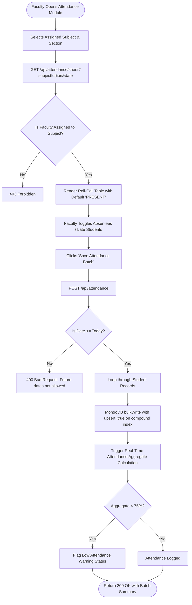
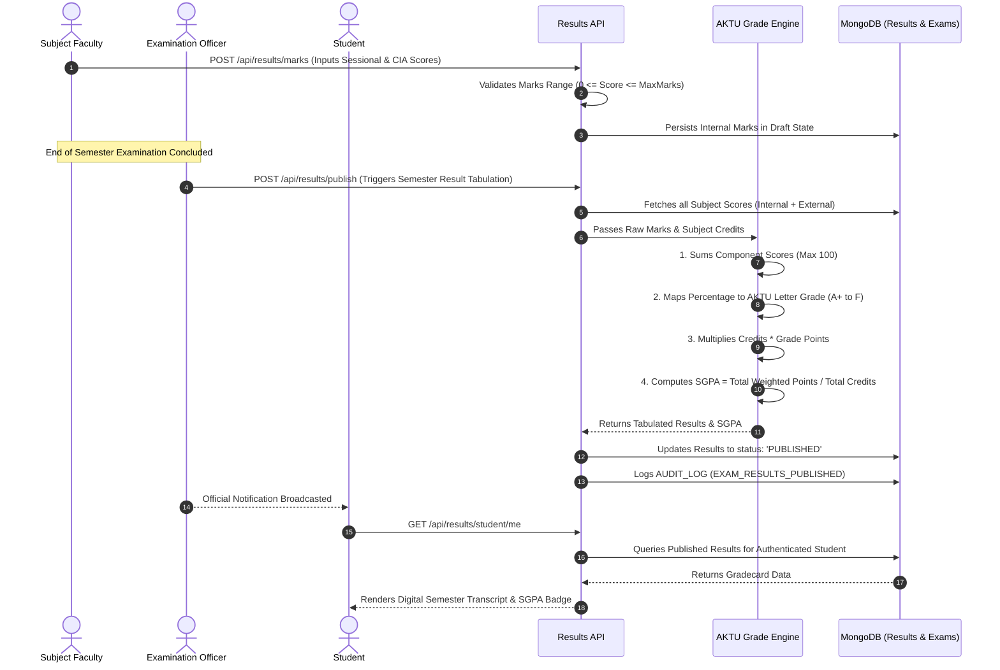
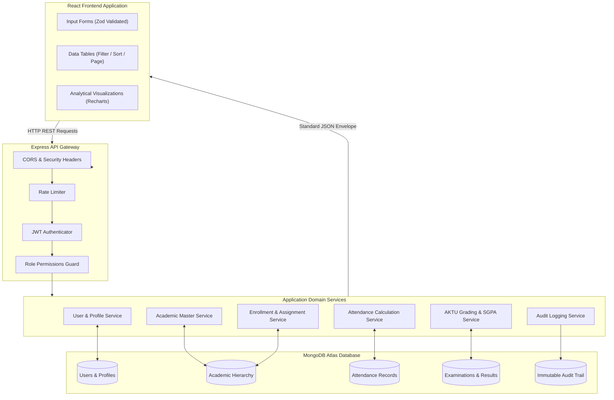

# Student Management System (SMS)
## Document 09: System Architecture, Workflows & Application Data Flow

---

### 1. High-Level 3-Tier System Architecture

The Student Management System is constructed upon a high-performance, decoupled three-tier architecture:
- **Presentation Tier (Client):** Single Page Application (SPA) built with React 18 and Vite, styled with Tailwind CSS, utilizing React Router for declarative navigation and TanStack Query for cache synchronization. Hosted on **Vercel's Global Edge Network**.
- **Application Tier (Server):** Asynchronous, event-driven RESTful API server executed by Node.js and Express.js. Implements Helmet, CORS, Rate-Limiting, JWT verification, RBAC authorization, and Zod validation middleware. Hosted on **Render Container Services**.
- **Data Tier (Database):** Fully managed, geo-replicated document database on **MongoDB Atlas** utilizing Mongoose ODM connection pooling with strict schema definitions and B-tree compound indexes.

---

### 2. Frontend-Backend-Database Request Lifecycle

Every client interaction follows a disciplined, predictable execution path through the technical stack:

---

### 3. Authentication & Session Workflow

---

### 4. Role-Based Dashboard Navigation Flow

---

### 5. Student Enrollment Workflow

---

### 6. Attendance Management Workflow

---

### 7. Internal Assessment & Result Processing Workflow

---

### 8. End-to-End Application Data Flow Architecture

